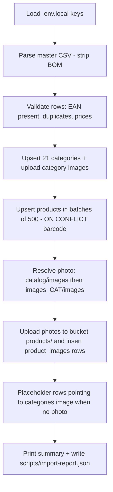

# Catalog Import — Barcode-keyed Products + Images

Import the full local catalog (9,913 products, 21 categories) from `catalog/` into the Supabase database, with the **barcode as the unique business identifier** of every product, every product detail from the CSV stored in the DB, and every product **linked to an image** (real photo when available, category generic photo as placeholder).

## Confirmed decisions

| Decision | Choice |
|---|---|
| Barcode as ID | Keep `products.id` UUID primary key; add **`barcode text UNIQUE`** as the business key. Import upserts `ON CONFLICT (barcode)`. No breaking changes to orders/cart/admin. |
| Default stock | `stock_quantity = 100` on **insert only** (re-import never resets stock adjusted in admin). |
| Missing photos | Use the category generic image (`catalog/images/categories/cat_*.jpg`) as the product's image, as the CSV itself intends. |
| Source of truth | Master CSV `catalog/קטלוג_מוצרים_מתוקן_מלא.csv` (the 21 per-category CSVs are subsets of it). |

## Current state (findings)

- `products` ([schema](../supabase/migrations/20260101000001_schema.sql)): uuid PK, `slug` unique, `name_he/name_ar`, `description_he/description_ar`, `price_agorot`, `compare_at_price_agorot`, `cost_agorot`, `stock_quantity`, `low_stock_threshold`, `is_active`, `sort_order`. **No barcode / weighted / item-code fields.**
- `product_images`: `product_id` FK + `storage_path` pointing into the public Supabase Storage bucket `product-images` (created in [0004_rls.sql](../supabase/migrations/20260101000004_rls.sql)). Storefront resolves images via [`productImageUrl()`](../lib/utils/images.ts:16).
- `categories`: `name_he`, `name_ar`, `slug`, `sort_order`. **No image column.**
- Master CSV columns (Hebrew headers, UTF-8 with BOM, quoted fields):
  `קוד פריט, תאור פריט, בר-קוד מקורי, מחיר צרכן, שקיל, תיאור המוצר, תמונה למוצר, תמונה גנרית למחלקה (מקומי), בר-קוד מאומת (EAN), מחלקה / קטגוריה, סטטוס אימות ברקוד`
- Every row has a value in **בר-קוד מאומת (EAN)** — real EAN-13, or the internal item code for weighed items (e.g. `131`). This is the unique key.
- Photo sources (barcode-named jpgs): `catalog/images/` (primary, also has `categories/` with 21 `cat_*.jpg` and a `_cache/` to ignore) and `images_CAT/images/` (secondary/supplementary).
- Env: local Supabase stack; keys in `.env.local` (`NEXT_PUBLIC_SUPABASE_URL`, `SUPABASE_SERVICE_ROLE_KEY`).

## 1. DB migration — `supabase/migrations/20260101000011_product_barcode.sql`

```sql
alter table products
  add column if not exists barcode        text unique,   -- verified EAN; business key (null only for legacy demo rows)
  add column if not exists barcode_original text,        -- בר-קוד מקורי from CSV
  add column if not exists item_code      text,          -- קוד פריט
  add column if not exists is_weighted    boolean not null default false,  -- שקיל
  add column if not exists barcode_status text;          -- סטטוס אימות ברקוד

create index if not exists idx_products_barcode on products(barcode);

alter table categories
  add column if not exists image_path text;  -- storage path of category generic image
```

Notes:
- Postgres `UNIQUE` allows multiple NULLs → existing demo products (no barcode) are unaffected.
- Apply with `npx supabase migration up` (local stack keeps existing data). `make db-reset` also works for a fresh dev DB.

## 2. Category mapping (21)

Keyed by the CSV's generic-image filename (exactly 21 distinct values), so mapping is derived from the data itself:

| # | name_he (CSV) | slug | name_ar | image |
|---|---|---|---|---|
| 01 | חלב, גבינות וביצים | dairy-cheese-eggs | ألبان وأجبان وبيض | cat_dairy.jpg |
| 02 | בשר ועופות | meat-poultry | لحوم ودواجن | cat_meat.jpg |
| 03 | דגים ופירות ים | fish-seafood | أسماك ومأكولات بحرية | cat_fish.jpg |
| 04 | פירות, ירקות ופיצוחים | produce-nuts | فواكه وخضروات ومكسرات | cat_produce.jpg |
| 05 | גלידות וקפואים | icecream-frozen | مثلجات ومجمدات | cat_frozen.jpg |
| 06 | לחם, מאפים ודגנים | bread-bakery-cereals | خبز ومعجنات وحبوب | cat_bakery.jpg |
| 07 | פסטה, אורז וקטניות | pasta-rice-legumes | معكرونة وأرز وبقوليات | cat_pasta.jpg |
| 08 | שימורים, רטבים וסלטים | canned-sauces-salads | معلبات وصلصات وسلطات | cat_canned.jpg |
| 09 | שמן וחומץ | oil-vinegar | زيت وخل | cat_oil.jpg |
| 10 | תבלינים ואפייה | spices-baking | توابل ومواد خبز | cat_spices.jpg |
| 11 | חטיפים וממתקים | snacks-sweets | وجبات خفيفة وحلويات | cat_snacks.jpg |
| 12 | שוקולד וממרחים מתוקים | chocolate-spreads | شوكولاتة ومربى | cat_chocolate.jpg |
| 13 | קפה ותה | coffee-tea | قهوة وشاي | cat_coffee.jpg |
| 14 | שתייה קלה ומיצים | soft-drinks-juices | مشروبات غازية وعصائر | cat_drinks.jpg |
| 15 | מים מינרליים וסודה | water-soda | مياه معدنية وصودا | cat_water.jpg |
| 16 | משקאות אנרגיה ובירה | energy-beer | مشروبات طاقة وبيرة | cat_energy.jpg |
| 17 | תינוקות | baby-products | أطفال | cat_baby.jpg |
| 18 | טיפוח והיגיינה | personal-care-hygiene | عناية ونظافة شخصية | cat_care.jpg |
| 19 | ניקיון וכביסה | cleaning-laundry | تنظيف وغسيل | cat_cleaning.jpg |
| 20 | חד פעמי ומוצרי בית | disposables-home | أحادية الاستعمال ولوازم المنزل | cat_home.jpg |
| 21 | פנאי, חשמל וכללי | electronics-leisure | ترفيه وكهربائيات وعام | cat_general.jpg |

`sort_order` = 1..21 by file numbering. Unknown category names (if any) get a generated slug and are listed in the import report.

## 3. CSV → DB field mapping

| CSV column | DB target | Transformation |
|---|---|---|
| בר-קוד מאומת (EAN) | `products.barcode` + `products.slug` | trim, strip trailing `.0`; slug = the barcode digits (unique, URL-safe) |
| תאור פריט | `products.name_he` | trim |
| תיאור המוצר | `products.description_he` | trim |
| מחיר צרכן | `products.price_agorot` | `Math.round(shekels * 100)`; invalid/empty → price 0 + `is_active=false` + report |
| שקיל | `products.is_weighted` | `"True"` → true |
| קוד פריט | `products.item_code` | text |
| בר-קוד מקורי | `products.barcode_original` | text, may be empty |
| סטטוס אימות ברקוד | `products.barcode_status` | text |
| מחלקה / קטגוריה | `products.category_id` | via category mapping above |
| תמונה למוצר | `product_images.storage_path` | resolved against real files (see §4) |
| תמונה גנרית למחלקה | `categories.image_path` + placeholder | `categories/cat_*.jpg` in bucket |
| — | `products.stock_quantity` | 100 on insert only |
| — | `products.name_ar` / `description_ar` | null (app falls back to Hebrew at display time) |
| — | `products.is_active`, `sort_order` | true; sequential index within category |

## 4. Image pipeline — "images in the right place with the right linkage"

Storage bucket: `product-images` (public read, already configured).

```
product photo lookup order for barcode B:
  1. catalog/images/B.jpg        → upload to  products/B.jpg
  2. images_CAT/images/B.jpg     → upload to  products/B.jpg
  3. none                        → link row to  categories/cat_X.jpg  (shared placeholder)
category images:
  catalog/images/categories/cat_*.jpg → upload to categories/cat_*.jpg
```

- Every imported product gets exactly one `product_images` row (`sort_order=0`, `alt_text=name_he`) → `productImageUrl()` always returns a real image; the `/products/<slug>.svg` demo fallback is never needed for catalog items.
- Uploads use `upsert: true`, `contentType: image/jpeg`; existing bucket objects are listed once and skipped.
- `catalog/images/_cache/` is ignored.

## 5. Import script — `scripts/import-catalog.mjs`

Node ESM script (no TS runner in project). New devDependency: `csv-parse` (robust quoted-CSV parsing; the file contains embedded commas, backticks and escaped quotes). Env loaded by parsing `.env.local` directly (no dotenv dependency).



CLI:
```
node scripts/import-catalog.mjs [--csv <path>] [--dry-run] [--limit N] [--deactivate-demo]
```
- `--dry-run` — parse + validate + report only, zero writes.
- `--deactivate-demo` — optional: set `is_active=false` for the 8 seed demo products / demo categories without barcode.

Idempotency (safe to re-run):
- categories: `ON CONFLICT (slug) DO UPDATE`
- products: `ON CONFLICT (barcode) DO UPDATE` — updates name/description/price/category/flags; **never touches `stock_quantity`**
- product_images: existing rows fetched once into a set; only missing links inserted
- storage: existing objects listed once; only missing files uploaded

Edge cases handled + reported:
- duplicate EANs in CSV → first occurrence wins, rest listed in report
- missing/invalid price → imported inactive with price 0, listed in report
- empty EAN → row skipped, listed in report
- CSV image path pointing to a non-existent file → placeholder used
- Hebrew/UTF-8 BOM file names and content

Report (`scripts/import-report.json` + console): categories upserted, products inserted/updated/skipped, photos uploaded, placeholders linked, duplicates, anomalies.

## 6. App code updates

1. [`types/database.types.ts`](../types/database.types.ts) — `Product`: add `barcode`, `barcode_original`, `item_code`, `is_weighted`, `barcode_status`; `Category`: add `image_path`.
2. [`lib/validations/product.ts`](../lib/validations/product.ts:9) — add optional `barcode` field (digits, 3–14 chars, or empty).
3. [`components/admin/product-form.tsx`](../components/admin/product-form.tsx) — barcode input in the admin product editor.
4. [`lib/actions/products.ts`](../lib/actions/products.ts) — persist `barcode` on create/update; map Postgres unique-violation `23505` on barcode to a friendly "barcode already exists" error.
5. `messages/*.json` — label + error keys for the barcode field (he / ar, matching existing key structure).
6. Data layer needs no change — `lib/data/products.ts` and storefront queries use `select("*")`, new columns flow through automatically.

Optional (only if trivially small): show barcode on the admin products table row.

## 7. Execution & verification

1. `npm i -D csv-parse`
2. Apply migration: `npx supabase migration up` (stack running via `make db-start`)
3. `node scripts/import-catalog.mjs --dry-run` → review report (expect ~9,913 valid rows, 21 categories)
4. `node scripts/import-catalog.mjs` → full import
5. DB spot-check: 21 categories; ~9,913 products with non-null barcode; every product has ≥1 `product_images` row; products with real photos point to `products/<barcode>.jpg`
6. UI check: storefront category pages show products with images (photo or category placeholder); product page shows price/name; admin product editor shows + saves barcode; duplicate barcode rejected with friendly error
7. `npm run typecheck && npm run lint && npm test`
8. Re-run the import once more to prove idempotency (0 inserted, N updated, stock untouched)

## Out of scope

- Weighted-product pricing UX (price-per-kg flow) — `is_weighted` flag is stored for future use
- Arabic product names/descriptions — CSV is Hebrew-only; display falls back to Hebrew by design
- Downloading missing photos from OpenFoodFacts (`images_CAT/update_manufacturer_photos_optional.py` already exists for that, optional separate run)
- Changing `order_items` / cart / checkout logic — untouched by design
